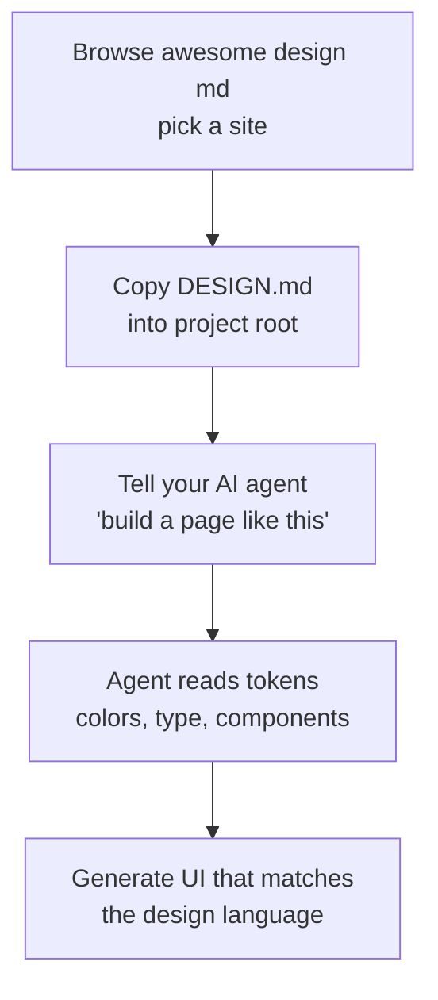

# awesome design md (2026): The Complete Guide to Google's DESIGN.md Collection

## 🎯 Core Takeaways (TL;DR)

- **awesome design md** is the fastest-growing community collection of `DESIGN.md` files on GitHub — VoltAgent's repository has surpassed **108,000 stars** and ranks **#105 globally** on GitHub as of August 2026.
- It ships **73 ready-to-use DESIGN.md files** extracted from real websites like Stripe, Vercel, Linear, Figma, Tesla, and Spotify — drop one into your project, tell your AI agent "build me a page that looks like this," and get visually consistent UI.
- Every entry in the **awesome design md** collection includes a full `DESIGN.md` plus `preview.html` and `preview-dark.html`, covering 9 sections from color tokens and typography to component states and responsive behavior.
- **awesome design md** is built on the DESIGN.md standard that Google Stitch introduced and Google Labs open-sourced as a draft specification on April 21, 2026 — a plain-text markdown file that AI agents read to generate consistent UI.

## Table of Contents

1. [What Is awesome design md?](#what-is-awesome-design-md)
2. [What Is DESIGN.md and Why Does It Matter?](#what-is-designmd)
3. [What's Inside the awesome design md Collection](#whats-inside)
4. [How to Use awesome design md with AI Agents](#how-to-use)
5. [Top Design Systems in awesome design md](#top-design-systems)
6. [How awesome design md Compares to Alternatives](#alternatives)
7. [FAQ](#faq)

## What Is awesome design md?

**awesome design md** is a curated GitHub repository by [VoltAgent](https://github.com/VoltAgent/voltagent) that collects `DESIGN.md` files analyzed from developer-focused websites. Its tagline is simple: copy a DESIGN.md into your project, tell your AI agent "build me a page that looks like this," and generate high-quality UI that stays visually consistent with the design language.

The repository — [github.com/voltagent/awesome-design-md](https://github.com/voltagent/awesome-design-md) — describes itself as a "curated collection of DESIGN.md analysis by developer focused websites." Since launching in March 2026, **awesome design md** has grown to **108,000+ stars** and a **global GitHub rank of #105**, making it one of the most-starred AI tooling repos of the year. It carries the official [Awesome badge](https://awesome.re), a Discord community, and a sponsorship channel.

Why did **awesome design md** explode so fast? Because it fills a real gap: AI coding agents are great at writing code but bad at guessing your design language. **awesome design md** hands them the design system in the one format they read best — plain markdown.

> 💡 **Professional Tip:** The repo is MIT-licensed and every DESIGN.md inside is provided "as is" for generating consistent UI. The design tokens represent publicly visible CSS values — VoltAgent doesn't claim ownership of any brand's visual identity, so you can safely drop them into personal and commercial projects.

## What Is DESIGN.md and Why Does It Matter?

To understand **awesome design md**, you first need to understand DESIGN.md. DESIGN.md is a new concept introduced by **Google Stitch** — a plain-text design system document that AI agents read to generate consistent UI. It's just a markdown file: no Figma exports, no JSON schemas, no special tooling. Drop it into your project root, and any AI coding agent or Google Stitch instantly understands how your UI should look.

The mental model pairs it with the AGENTS.md convention:

| File | Who reads it | What it defines |
|------|-------------|-----------------|
| `AGENTS.md` | Coding agents | How to build the project |
| `DESIGN.md` | Design agents | How the project should look and feel |

On April 21, 2026, Google Labs open-sourced the draft specification of DESIGN.md, and the standard went mainstream — within days, the official spec repo crossed 10,000 stars while **awesome design md** surged past 68,000. Today **awesome design md** is widely cited — including in design tutorials from banani.co and design-bootcamp — as the single most popular resource for ready-made DESIGN.md files.

That's the entire point of **awesome design md**: instead of writing a design system from scratch, you borrow one that has already been extracted, analyzed, and structured by a team that cares about quality.

## What's Inside the awesome design md Collection

**awesome design md** currently hosts **73 DESIGN.md files** organized into 9 categories. Each entry follows the Stitch DESIGN.md format with extended sections:

| # | Section | What it captures |
|---|---------|-----------------|
| 1 | Visual Theme & Atmosphere | Mood, density, design philosophy |
| 2 | Color Palette & Roles | Semantic name + hex + functional role |
| 3 | Typography Rules | Font families, full hierarchy table |
| 4 | Component Stylings | Buttons, cards, inputs, navigation with states |
| 5 | Layout Principles | Spacing scale, grid, whitespace philosophy |
| 6 | Depth & Elevation | Shadow system, surface hierarchy |
| 7 | Do's and Don'ts | Design guardrails and anti-patterns |
| 8 | Responsive Behavior | Breakpoints, touch targets, collapsing strategy |
| 9 | Agent Prompt Guide | Quick color reference, ready-to-use prompts |

Each site in **awesome design md** ships three files:

| File | Purpose |
|------|---------|
| `DESIGN.md` | The design system (what agents read) |
| `preview.html` | Visual catalog: color swatches, type scale, buttons, cards |
| `preview-dark.html` | Same catalog with dark surfaces |

The categories inside **awesome design md** span the full spectrum of modern web design: AI & LLM Platforms (Claude, Ollama, Mistral, xAI), Developer Tools & IDEs (Cursor, Vercel, Raycast, Warp), Backend & DevOps (Supabase, MongoDB, Sentry), Productivity & SaaS (Linear, Notion, Cal.com), Design & Creative (Figma, Framer, Webflow), Fintech & Crypto (Stripe, Coinbase, Binance), E-commerce (Shopify, Nike, Airbnb), Media & Consumer Tech (Apple, NVIDIA, Spotify), and even Automotive (Tesla, Ferrari, Bugatti).

**awesome design md** also has a delightfully quirky series: **Retro Web · DESIGN.md Nostalgia**. A Saturday series with period-accurate vintage UI — like Dell (1996) with "hand-cut GIF stickers" and Nintendo.com (2001) with "brushed-periwinkle beveled metal panels" — so you can tell your agent to build a time-capsule webpage.

> ✅ **Best Practice:** Not sure where to start with **awesome design md**? Pick a brand whose aesthetic you already admire — Vercel for black-and-white precision, Linear for ultra-minimal purple-accented UI, or Stripe for signature purple gradients. The design language you ship is the design language you live in.

## How to Use awesome design md with AI Agents

Using **awesome design md** takes about two minutes:

1. **Browse the collection** — open [github.com/voltagent/awesome-design-md](https://github.com/voltagent/awesome-design-md) and pick a design system from the list (each links to a `getdesign.md/<brand>/design-md` page).
2. **Copy the DESIGN.md** into your project root, next to your AGENTS.md.
3. **Prompt your agent** — say "build me a landing page that matches the design in DESIGN.md," and Claude Code, OpenCode, Cursor, or any modern coding agent will follow the tokens and rules.
4. **Iterate** — use the Do's and Don'ts section of **awesome design md** files as guardrails, and check `preview.html` to see expected colors and type at a glance.

Community tutorials (including a popular YouTube walkthrough pairing **awesome design md** with OpenCode and Claude) confirm the workflow "is SO EASY & SO GOOD" — the hardest part is choosing which brand's aesthetic you want.

> 💡 **Professional Tip:** **awesome design md** maintainers accept requests at getdesign.md/request — you can request a DESIGN.md for a specific website, including private requests delivered exclusively to you. If your favorite brand isn't in the collection yet, that's the fastest way to fix it.

## Top Design Systems in awesome design md

Here's a taste of what's inside **awesome design md** right now:

| Brand | Category | Design language captured |
|-------|----------|--------------------------|
| Vercel | Dev tools | Black and white precision, Geist font |
| Linear | SaaS | Ultra-minimal, precise, purple accent |
| Stripe | Fintech | Signature purple gradients, weight-300 elegance |
| Claude | AI platforms | Warm terracotta accent, clean editorial layout |
| Figma | Design tools | Vibrant multi-color, playful yet professional |
| Supabase | Backend | Dark emerald theme, code-first |
| Shopify | E-commerce | Dark-first cinematic, neon green accent |
| Tesla | Automotive | Radical subtraction, cinematic photography |
| Spotify | Media | Vibrant green on dark, album-art-driven |
| Nintendo (2001) | Retro | Y2K console chrome, halftone-dotted carbon nav |

Each of these entries took real work to produce — **awesome design md** isn't a list of links, it's a collection of deep design analysis. The repo's own description emphasizes "real design depth — including analyzed patterns, tokens, and rules — for high-quality UI generation, not surface-level outputs."

## How awesome design md Compares to Alternatives

If you're evaluating **awesome design md** against the alternatives, here's the honest comparison:

| Aspect | awesome design md | Write your own DESIGN.md | Design tokens from Figma |
|--------|-------------------|--------------------------|--------------------------|
| Time to first UI | Minutes | Hours to days | Requires tooling/exports |
| Depth of analysis | 9 sections per file | Depends on your effort | Design tokens only, no rules |
| Brand aesthetics | 73 real brands | Your own | Your own |
| Cost | Free (MIT) | Your time | Figma subscription |
| Agent readiness | Built for LLMs | Built for LLMs | Needs conversion |

The gap **awesome design md** fills is the "starting point": it gives you a production-quality design system instantly, with previews, and lets you adapt it later. As one design-bootcamp analysis put it, "Google makes DESIGN.md open source on its way to becoming an industry standard" — and **awesome design md** is the community's biggest bet on that standard.

> ⚠️ **Attention:** DESIGN.md files in **awesome design md** replicate publicly visible CSS values of real brands. If you copy a brand's exact look for a client product, consider mixing palettes or renaming tokens so you build on the patterns rather than clone the brand.

## 🤔 FAQ: awesome design md

### Q: What is awesome design md?

A: **awesome design md** is a GitHub repository by VoltAgent that curates DESIGN.md files extracted from 73 real websites — including Stripe, Vercel, Linear, Figma, and Tesla — so you can drop one into your project and have AI agents generate matching UI. It has over 108,000 stars.

### Q: Where can I find awesome design md?

A: **awesome design md** lives at [github.com/voltagent/awesome-design-md](https://github.com/voltagent/awesome-design-md). Individual DESIGN.md files are hosted at getdesign.md (e.g., getdesign.md/stripe/design-md).

### Q: Is awesome design md free to use?

A: Yes. **awesome design md** is MIT-licensed, and each included DESIGN.md is provided "as is" without warranty. You can use the files commercially, though the maintainers note the design tokens represent publicly visible CSS values and they don't claim ownership of any brand's identity.

### Q: What is DESIGN.md?

A: DESIGN.md is a plain-text design system document introduced by Google Stitch and open-sourced as a draft specification by Google Labs on April 21, 2026. It's a markdown file that defines colors, typography, components, layout, and rules so AI agents can generate visually consistent UI. **awesome design md** is the biggest community collection of such files.

### Q: How many DESIGN.md files are in awesome design md?

A: **awesome design md** currently contains 73 DESIGN.md files across 9 categories — from AI platforms and developer tools to fintech, e-commerce, automotive, and a retro 1990s series.

### Q: What does each file in awesome design md include?

A: Each entry in **awesome design md** includes a `DESIGN.md` (design system with 9 sections: theme, colors, typography, components, layout, elevation, do's and don'ts, responsive behavior, and agent prompt guide) plus `preview.html` and `preview-dark.html` visual catalogs.

### Q: How do I use awesome design md with my AI agent?

A: Copy a DESIGN.md from **awesome design md** into your project root, then prompt your agent with something like "build me a page that looks like this." Agents like Claude Code, Cursor, and OpenCode read the markdown directly — no conversion or tooling needed.

### Q: Can I request a new DESIGN.md?

A: Yes — the **awesome design md** team accepts requests at getdesign.md/request, including private requests delivered exclusively to you. You can also contribute improvements via pull requests after opening an issue.

## Summary & Recommended Actions

**awesome design md** is the rare GitHub phenomenon that arrived at exactly the right moment: DESIGN.md went from a Google Stitch experiment to an open industry standard in April 2026, and **awesome design md** became the community's default library for it — 108K stars, 73 design systems, and a global rank of #105.

If you build UI with AI agents, **awesome design md** is the fastest way to go from blank page to polished, design-consistent interface. It's free, MIT-licensed, deeply analyzed, and actively maintained.

Your next steps:

1. **Star the repo** — follow [github.com/voltagent/awesome-design-md](https://github.com/voltagent/awesome-design-md) to track updates and new additions.
2. **Try one today** — copy the Vercel or Linear DESIGN.md into a scratch project and ask your agent to build a landing page; you'll see the difference within minutes.
3. **Contribute or request** — found a wrong color or missing token? Open an issue or PR. Need a brand that's not there? Use the getdesign.md request form.

---

**Sources:** [awesome design md on GitHub](https://github.com/voltagent/awesome-design-md) · [Google Stitch DESIGN.md overview](https://stitch.withgoogle.com/docs/design-md/overview/) · [Google Labs: DESIGN.md format open-sourced](https://blog.google/innovation-and-ai/models-and-research/google-labs/stitch-design-md) · [Google: Design UI using AI with Stitch](https://blog.google/innovation-and-ai/models-and-research/google-labs/stitch-ai-ui-design) · [Star History for awesome design md](https://www.star-history.com/voltagent/awesome-design-md) · [Banani: What Is Design.md and How to Use It](https://www.banani.co/blog/design-md-guide) · [Medium: Google Makes DESIGN.md Open Source](https://medium.com/design-bootcamp/google-makes-design-md-open-source-on-its-way-to-become-a-industry-standard-16119f2368dd)
